<p align="center">
  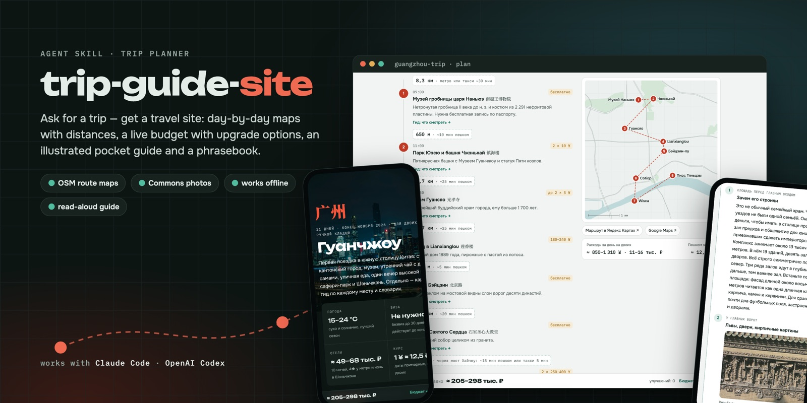
</p>

<p align="center">
  <a href="https://woipot.github.io/trip-guide-site/"></a>
  <a href="#install"></a>
  <a href="#install"></a>
  
  <a href="LICENSE"></a>
</p>

<p align="center">
  <b>Ask your agent for a trip. Get a travel site.</b><br>
  Day-by-day route maps with distances · a live budget with upgrade options · an illustrated offline pocket guide · a phrasebook with big-text display and speech.
</p>

<p align="center">
  <a href="https://woipot.github.io/trip-guide-site/"><b>Open the live demo →</b></a>
  &nbsp;·&nbsp; <a href="#install">Install</a>
  &nbsp;·&nbsp; <a href="#how-it-works">How it works</a>
  &nbsp;·&nbsp; <a href="#кратко-по-русски">По-русски</a>
</p>

---

`trip-guide-site` is an Agent Skill for **Claude Code** and **OpenAI Codex**. You describe a trip in plain words ("11 days in Guangzhou at the end of November, hotel under 100k ₽, local food, one fancy dinner"). The agent researches the facts that can wreck a trip and agrees the program with you in chat. Then it builds three linked pages that you can open offline, host anywhere or publish as a private Claude Artifact.

The demo above is a real trip planned with this skill: 11 days in Guangzhou and Shenzhen, 28 guide chapters, 120+ freely licensed photos.

## What you get

### 1 · The plan

<table>
  <tr>
    <td width="50%">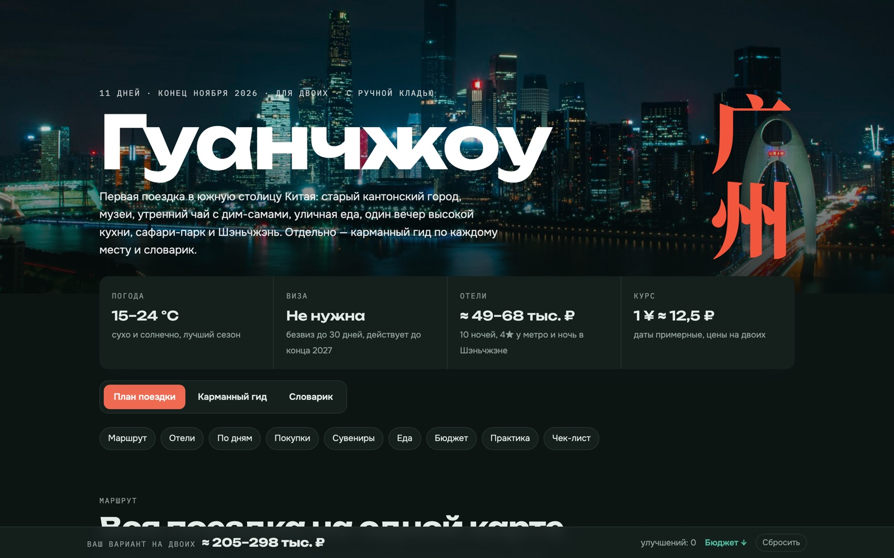</td>
    <td width="50%">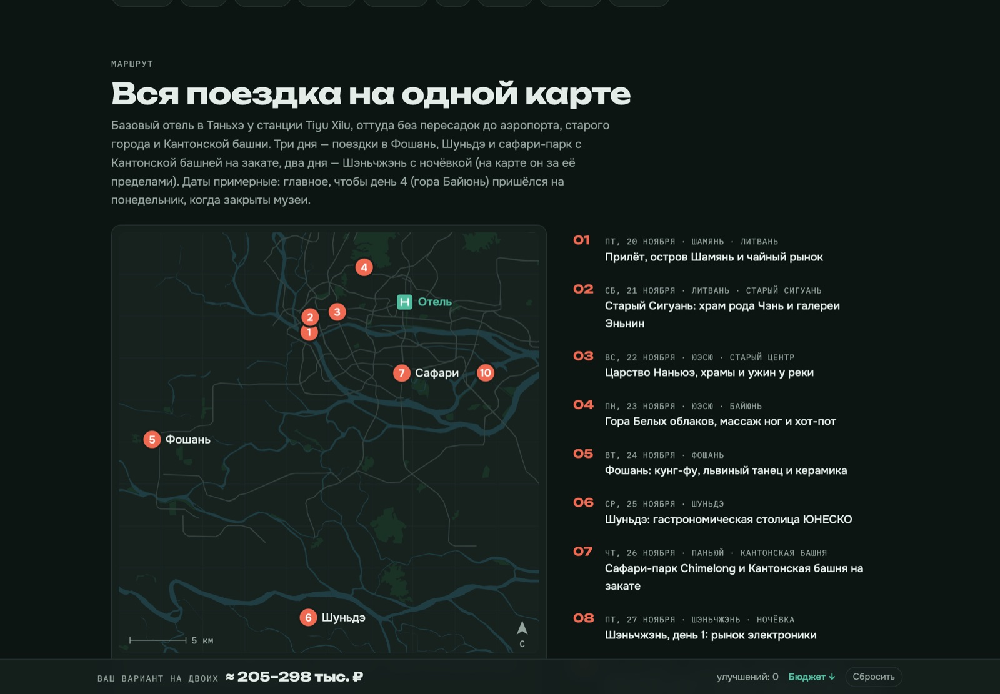</td>
  </tr>
  <tr>
    <td><b>Hero and key facts</b>: visa, weather, hotel budget, exchange rate. A sticky bar shows the running total.</td>
    <td><b>The whole trip on one map</b>, drawn from OpenStreetMap: rivers, parks, metro lines and one badge per day.</td>
  </tr>
  <tr>
    <td>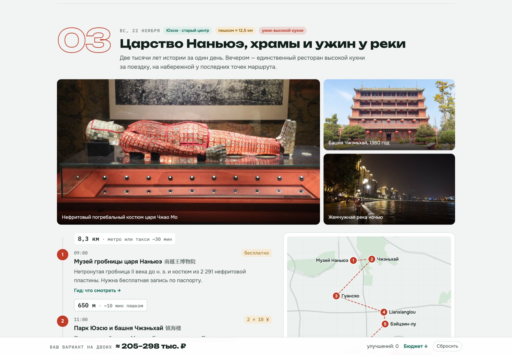</td>
    <td>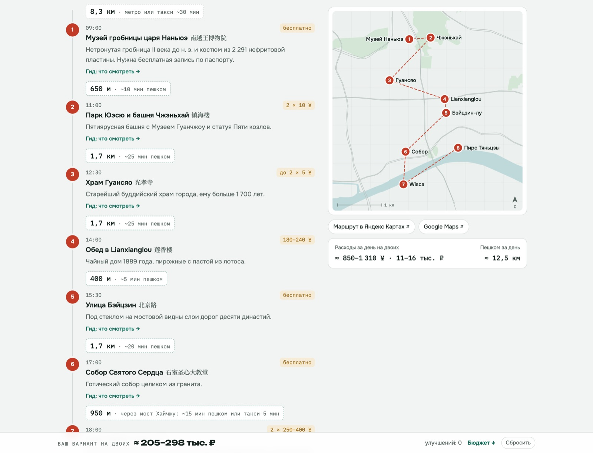</td>
  </tr>
  <tr>
    <td><b>A card for every day</b> with a photo gallery, the area, closures and the walking total.</td>
    <td><b>Timeline and route map.</b> Each leg shows its distance and how to get there (walk, taxi, metro), with a numbered map and one-tap routes in Yandex or Google Maps.</td>
  </tr>
  <tr>
    <td>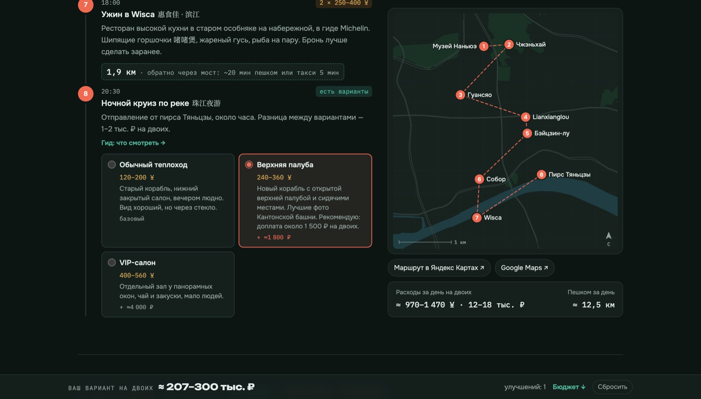</td>
    <td>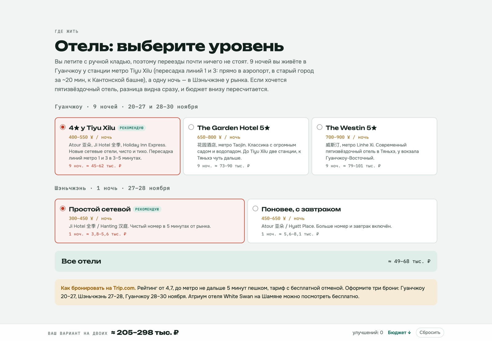</td>
  </tr>
  <tr>
    <td><b>Upgrades are a choice.</b> Where a better version costs little more (upper deck, observation level, train class), pick it and the day cost and total update live.</td>
    <td><b>A hotel picker per city</b>, with nights, price per night and the total in your home currency.</td>
  </tr>
  <tr>
    <td colspan="2">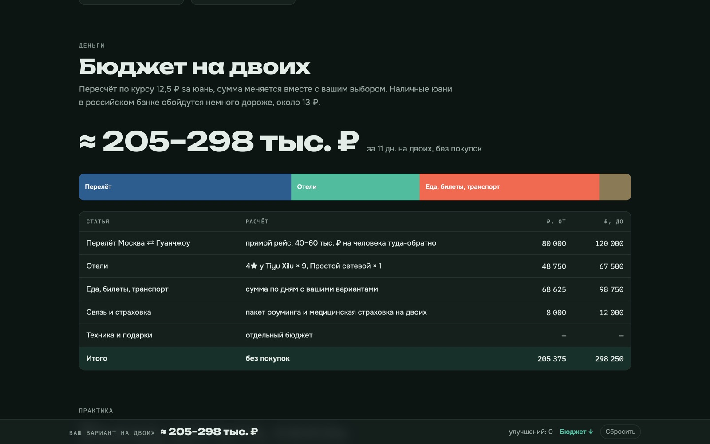</td>
  </tr>
  <tr>
    <td colspan="2"><b>Budget</b>: flights, hotels, food, tickets and transport, recalculated from your choices. The page also covers shopping, cheap souvenirs, where and what to eat, practical tips (entry, money, internet, apps) and a checklist.</td>
  </tr>
</table>

### 2 · The pocket guide

<table>
  <tr>
    <td width="50%">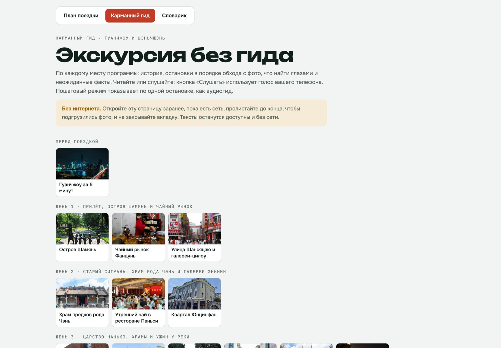</td>
    <td width="50%">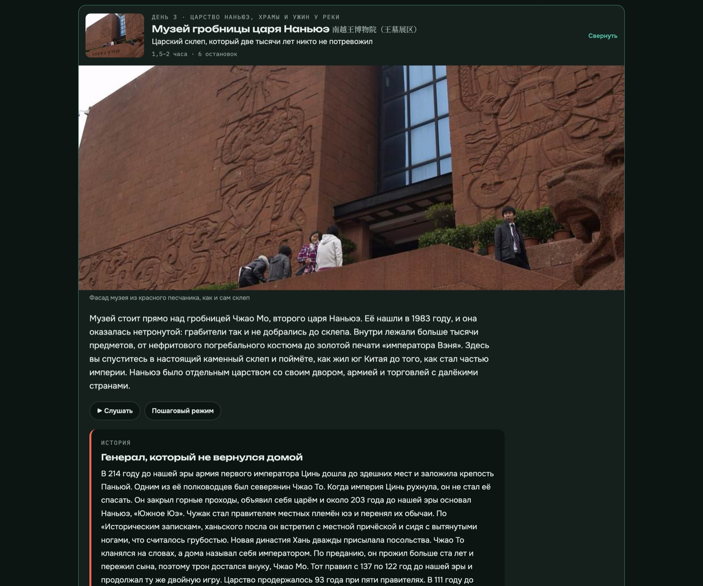</td>
  </tr>
  <tr>
    <td><b>One chapter per sight</b>, grouped by day. Every stop in the plan links to its chapter.</td>
    <td><b>A hook, an intro and a story</b>, then 5–7 stations in walking order with photos, a "find on site" checklist, did-you-know facts and a tip. <b>▶ Listen</b> reads it aloud and <b>step mode</b> works like an audio guide.</td>
  </tr>
</table>

Parallel "professional guide" sub-agents write the chapters. They fact-check dates, numbers and names on the web, label legends as legends, and choose CC-licensed photos that they look at before using.

### 3 · The phrasebook

<table>
  <tr>
    <td width="50%">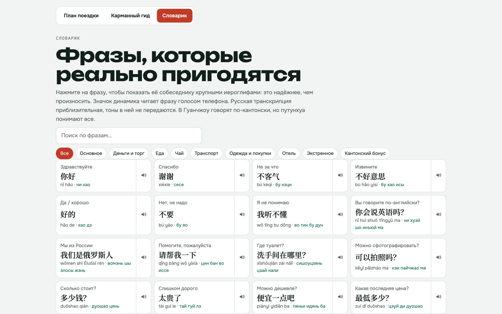</td>
    <td width="50%">
      <b>About 70 phrases you will actually use</b>, grouped into basics, bargaining, food, tea, transport, clothes, hotel, emergencies and a local-dialect bonus.<br><br>
      Search, tabs, native script plus transliteration plus Russian reading. Tap a phrase to show it in huge letters to a taxi driver. 🔊 plays it with the phone's voice.
    </td>
  </tr>
</table>

### Phone first

<p align="center">
  
  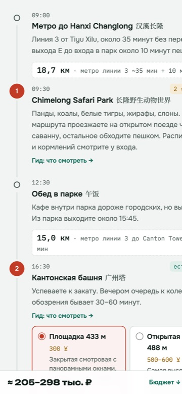
  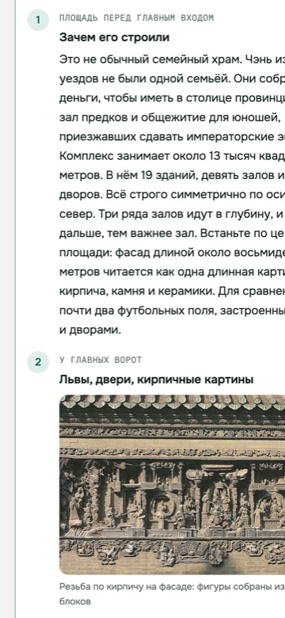
  
</p>

Every page works at phone width in light and dark themes. Choices, checklists and "found it" ticks are saved in the browser. Once a page is loaded, its texts and maps keep working without a network.

## Install

**Claude Code**

```bash
git clone --depth 1 https://github.com/woipot/trip-guide-site ~/.claude/skills/trip-guide-site
```

**OpenAI Codex**

```bash
git clone --depth 1 https://github.com/woipot/trip-guide-site ~/.agents/skills/trip-guide-site
```

Codex reads personal skills from `~/.agents/skills`. It also scans `.agents/skills` inside a repository, so you can vendor the skill into a project instead ([Codex skills docs](https://developers.openai.com/codex/skills)). Restart the agent after installing. `--depth 1` skips the `gh-pages` branch that hosts the demo.

## Quick start

Open Claude Code or Codex in an empty folder for the trip, then just ask:

> Plan 10 days in Istanbul in April for two, hotel up to €100/night, local food, one nice dinner.

> Хочу поехать в Гуанчжоу на неделю в конце ноября, отель до 100 тысяч на двоих, составь программу.

In Codex you can also call the skill explicitly with `$trip-guide-site …`.

The agent goes through these steps:

1. Asks only what it can't assume.
2. Researches entry rules, money, connectivity, closures and customs.
3. Shows the program as a table for you to adjust.
4. Builds the site.

To change something later, just say "убери 5-й день", "add the safari back" or "cheaper hotels" and it rebuilds.

## How it works

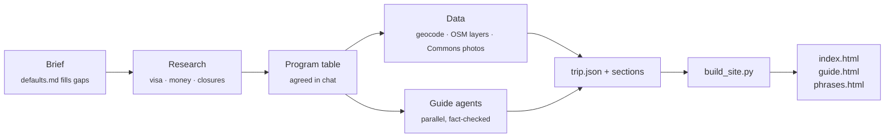

| Step | Tool |
|---|---|
| Coordinates | `scripts/geocode.py`: OpenStreetMap Nominatim at 1 request per second |
| Map layers | `scripts/osm_fetch.py`: water, parks and metro from Overpass; resumable |
| Photos | `scripts/commons_search.py`, `scripts/commons_fetch.py`: Wikimedia Commons, CC0/PD/CC BY/CC BY-SA only, credits recorded |
| Photo review | `scripts/contact_sheet.py`: one grid image so the agent can see what it picked |
| Maps | `scripts/maps.py`: SVG maps with numbered pins, route, scale bar and north arrow |
| Site | `scripts/build_site.py trip/ out/`: plan, guide and phrasebook pages; standalone `index.html` plus an Artifact fragment |

The data format is documented in [`references/trip-json.md`](references/trip-json.md), and the guide-writer prompt is in [`references/guide-agents.md`](references/guide-agents.md). A complete real trip folder lives in [`assets/example-guangzhou/`](assets/example-guangzhou). To build it offline:

```bash
python3 -I scripts/build_site.py assets/example-guangzhou /tmp/gz-site && open /tmp/gz-site/index.html
```

Without fetched data, the maps have no background layers and the photos are missing.

<details>
<summary><b>Repository layout</b></summary>

```
SKILL.md                     the skill: workflow and rules the agent follows
references/
  defaults.md                default brief: food caps, hotel level, design, options (edit to taste)
  research-checklist.md      facts to verify for any destination
  trip-json.md               data format of trip.json, days, stops and options
  guide-agents.md            prompt template for the guide-writer sub-agents
  publishing.md              preview, Artifact upload, static hosting
scripts/                     geocode · osm_fetch · commons_search/fetch · contact_sheet · maps · build_site
assets/
  style.css, main.js, guide.js, phrases.js
  example-guangzhou/         a real 11-day trip: trip.json, sections, 28 guide chapters
docs/                        README images
```
</details>

## Requirements

- Claude Code or Codex with web search, shell access and a writable working folder. Sub-agents and Claude's Artifact tool are optional: guide chapters can be written one after another, and the output is plain static HTML.
- Python 3.9+, standard library only.
- Photo compression uses `sips` (built into macOS) or [Pillow](https://pypi.org/project/Pillow/). Contact sheets use Pillow, or Swift on macOS.
- Internet access for research, Nominatim, Overpass and Wikimedia Commons.

## Customise

- **Your defaults.** Edit [`references/defaults.md`](references/defaults.md) to set the per-meal food cap, hotel level, preferred trip length, whether to show upgrade options, and so on.
- **Language.** The generated UI is in Russian. To use another language, translate the strings in `scripts/build_site.py` and `assets/*.js`.
- **Look.** All styling is in `assets/style.css`, which uses design tokens with light and dark themes.

## Data and licences

- Code: [MIT](LICENSE).
- Maps: © OpenStreetMap contributors, [ODbL](https://www.openstreetmap.org/copyright). The attribution is added to every generated site. Geocoding follows the [Nominatim usage policy](https://operations.osmfoundation.org/policies/nominatim/).
- Photos: Wikimedia Commons, CC0, public domain, CC BY and CC BY-SA. The author and licence of every photo are listed on the page that shows it, including in the demo. The screenshots in `docs/` contain these photos.
- Prices, visa rules and opening hours in generated plans are estimates as of the build date. Check them before you travel.

## Кратко по-русски

Скил для Claude Code и OpenAI Codex. Опишите поездку обычными словами: куда, когда, бюджет, что любите. Агент проверит визу, деньги, связь и выходные дни музеев. Потом он согласует с вами программу таблицей и соберёт сайт из трёх страниц:

- **План.** Карта на каждый день, расстояния и ходьба между точками, фото, выбор отелей и вариантов подороже, живой бюджет в рублях.
- **Карманный гид.** Главы с историей, остановками, фото и фактами. Их можно слушать голосом телефона или проходить пошагово.
- **Словарик.** Фразы, которые можно показать крупно таксисту.

[Демо: 11 дней в Гуанчжоу и Шэньчжэне →](https://woipot.github.io/trip-guide-site/)

Установка — одной командой из раздела [Install](#install). Цены и правила въезда в плане примерные, перед поездкой их нужно перепроверить.
